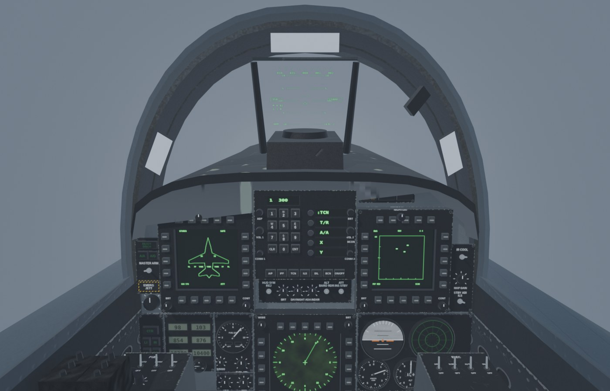
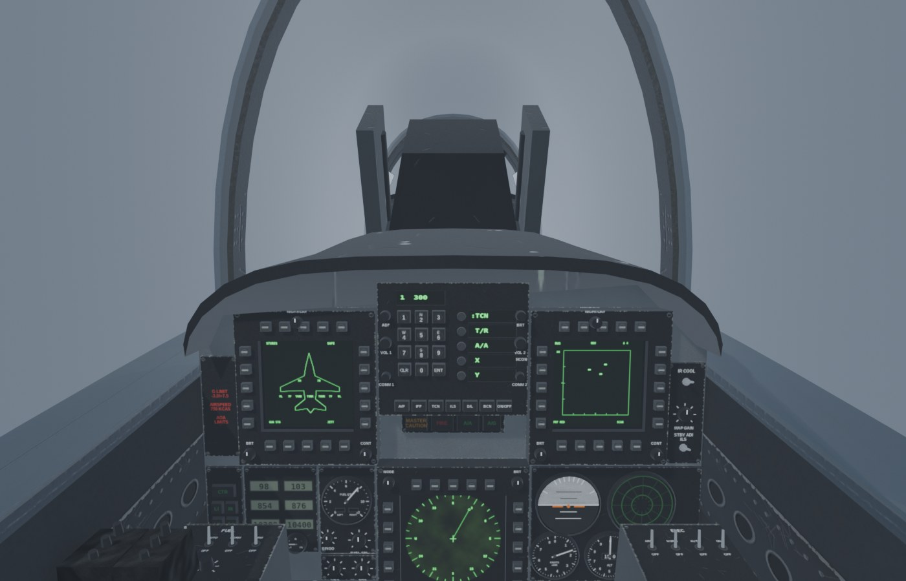
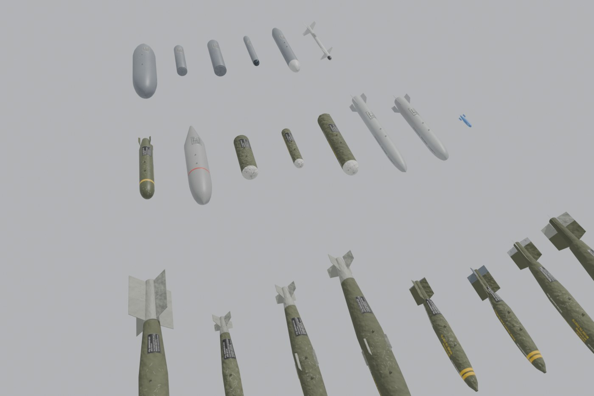
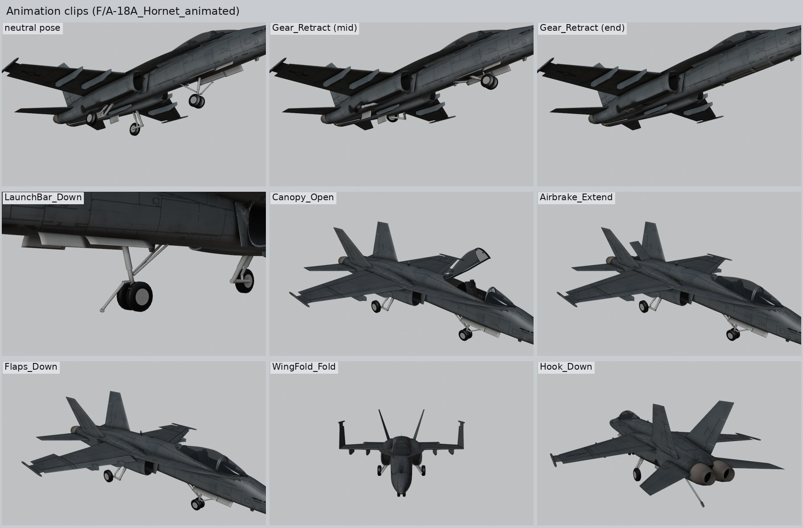

# Legacy Hornet models: F/A-18A and F/A-18B

Game-ready Blender models of the original McDonnell Douglas Hornet, built by
a script from the F/A-18A and F/A-18B general-arrangement drawings. This is
the legacy airframe, not the larger F/A-18E/F Super Hornet. Each variant has:

- weathered PBR textures (a worn fleet-service finish);
- a cockpit modelled from NASA photographs and NASA's F/A-18 cockpit layout
  drawing, with eye points for a first-person camera;
- the external stores the US Navy and Marine Corps carried on the A/B, with
  pylons, station sockets and example loadouts.




## Files

| File | What it is |
| --- | --- |
| `FA-18A_Hornet.blend`, `FA-18B_Hornet.blend` | The models. Textures are in `textures/`, referenced by relative path. |
| `FA-18A_Hornet.glb`, `FA-18B_Hornet.glb` | Same aircraft for game engines, textures embedded. Includes the airframe, cockpit, pylons, station sockets and cameras, with the gear down. Loadouts are not included. |
| `FA-18A_Hornet_animated.blend`, `FA-18B_Hornet_animated.blend` | Copies of the models with the animation clips set up by `tools/setup_animations.py` (the originals are untouched); `*_animated.glb` carry the clips as glTF animations, and `*_animated_report.txt` lists what was found and set up. |
| `FA-18_Stores.glb` | Every store, pylon, rack and launcher. Each node sits at the origin, which is also the store's attach point. |
| `FA-18A_stations.json`, `FA-18B_stations.json` | Station manifest: socket positions, what each station carries, store data and sources, and the loadouts. |
| `textures/` | Cockpit atlas, display images, exterior atlases and the stores atlas. |
| `fa18_hornet.py` | Generator for the airframe; it builds everything else by calling the modules below. |
| `fa18_cockpit.py`, `cockpit_layout.py` | Cockpit geometry, and the panel layout it shares with the texture painter. |
| `fa18_stores.py`, `stores_data.py` | Stores, pylons, sockets and loadouts, and the weapons data they use. |
| `fa18_materials.py` | PBR materials and the exterior bake. |
| `tools/` | Texture painters, reference-line prep, overlay check, model checks, preview renders, animation set-up. |
| `docs/weapons_research.md`, `.json` | Research notes behind every weapon number, with sources. |

## Variants

The two variants share everything except the crew area:

- **F/A-18A:** one seat. The canopy runs 3.22–7.15 m aft of the nose tip.
- **F/A-18B:** two seats in tandem. The canopy runs 3.18–8.70 m, with a frame between the
  cockpits and a raised spine behind them. The rear cockpit has its own instrument panel,
  without a HUD (head-up display).

## Regenerating

Tested with Blender 5.3 (the `bpy` module). It should also run on Blender
4.2+, but that is untested.

```sh
cd aircraft
# 1. paint the cockpit and stores textures (Python 3 with Pillow and numpy)
python tools/make_cockpit_textures.py
python tools/make_store_textures.py
# 2. optional, slow (about an hour on 4 CPU cores): re-bake the exterior textures.
#    Panel lines come from the F/A-18B drawing, which is not stored in this repo:
python tools/prepare_reference_lines.py PATH/TO/fa18b_sheet.gif /tmp/refs
blender -b -P fa18_hornet.py -- --variant A --bake --refs /tmp/refs/refs.json
blender -b -P fa18_hornet.py -- --variant B --bake fuselage --refs /tmp/refs/refs.json
# 3. build both variants, with GLB files and the stores library
blender -b -P fa18_hornet.py -- --variant both --glb
```

Options:

- `--variant A|B|both`
- `--out DIR`
- `--glb` (also writes `FA-18_Stores.glb`)
- `--bake [GROUP ...]`, `--refs`, `--samples`
- `--no-uv`

Without `--bake`, the build uses the textures already in `textures/`. The
wings, tail and gear atlases are shared by both variants; each variant has its
own fuselage atlas.

Rebuilds are deterministic. If you change exterior geometry, though, re-bake
that part's atlas: its automatic UV layout changes with the mesh.

## Structure and conventions

- Real-world scale in metres. The nose points along −Y, +Z is up and the port wing
  is on +X. glTF converts this on export as usual.
- One root empty per aircraft (`FA-18A_Hornet`), with its origin on the centreline at
  25 % of the mean aerodynamic chord.
- **Moving parts.** Each sits under a `<name>_Hinge` empty on its hinge line and rests
  at zero rotation; rotate it about its local X axis. Its `hinge` custom property (a
  glTF extra) records which way positive goes:

  | Part | Positive rotation |
  | --- | --- |
  | `Flap_*`, `Aileron_*`, `Stabilator_*` | trailing edge down |
  | `LEFlap_Inner_*`, `LEFlap_Outer_*` | leading edge down |
  | `Rudder_*` | trailing edge to starboard |
  | `Wing_Outer_*` | wing folds up (90° = folded) |
  | `Canopy` | opens (front edge up, hinged at the aft end) |
  | `SpeedBrake` | opens |
  | `ArrestingHook` | hook down |

- **Collections:**
  - `Landing Gear`
  - `Cockpit`
  - `Pylons` (fitted, as usual in service)
  - `Station Sockets`
  - `Optional` (extended refuelling probe, hidden)
  - `Loadouts` (hidden)
  - `Stores Library` (hidden, laid out beside the aircraft)

## Cockpit



**Sources.** All are public-domain NASA photographs:

- **ARC-1993-A83-0499-34**, NASA Ames, "F/A-18 Hornet cockpit": a layout drawing of the
  front cockpit. Its scale is about 1 mm per pixel, confirmed by the 8 in DDI bezels.
  The front instrument panel is laid out in millimetres from it, in `cockpit_layout.py`.
- **ED08-0252-06**, NASA 845, an F/A-18B: the rear instrument panel. It shows the same
  displays and lower panel as the front, without the HUD.
- **ED06-0075-11:** the HUD combiner and the canopy bow.
- **EC02-0102-1, AFRC2018-0104-04, ED08-0252-26, AFRC2026-0188-01:** the SJU-5/6 seats,
  the perforated sill longerons and the canopy interior.

The photos are searchable at images.nasa.gov. NASA additions seen in them (cameras,
video panels, the large test display) were left out.

**What is modelled:**

- **Main instrument panel, laid out as in the drawing:**
  - two DDIs (digital display indicators) with 20 push buttons each;
  - the up-front control panel: keypad, five option windows, scratchpad and function row;
  - the HUD control panel;
  - glareshield warning lights (FIRE, MASTER CAUTION, APU FIRE);
  - the master arm panel;
  - jettison station select and flap/gear lights;
  - the engine monitor display and fuel quantity gauge;
  - HDG/CRS knobs;
  - the horizontal situation display;
  - standby attitude, airspeed, altimeter and vertical-speed instruments, and the RWR
    (radar warning receiver) azimuth indicator.
- **Glareshield coaming and HUD:** the HUD has its projector body, side posts and a tilted
  combiner.
- **Canopy bow:** three rear-view mirrors and the AIM-7 LOCK/SHOOT lights.
- **Ejection seats:** Martin-Baker SJU-5/A (front) and SJU-6/A (rear), with headbox,
  parachute container, side beams, gas-generator tubes, survival-kit cushion, harness and
  the yellow-and-black firing handle.
- **Controls:** the control stick, throttle quadrant with HOTAS grips, and rudder pedals.
- **Side consoles.**
- **Tub:** walls and a floor cut into the fuselage, the perforated canopy-sill
  longerons, and a foot well under the panel.
- **Canopy and windscreen:** separate thin transparencies (1.4 cm), so you can sit inside.

**Displays for a game.** Every screen is its own object, with 0–1 UVs and its own
material:

- `DDI_L_*`, `DDI_R_*`, `HSD_*`
- `UFC_*` (scratchpad plus the five option windows)
- `HUD_Combiner_*` (alpha)

Each object has a `display` property. Swap in render textures to drive them live. The
supplied images (stores page, radar page, map, UFC readout, HUD symbology) are
representative Hornet-style formats, not recordings.

**First-person.**
- `Eye_Front` and `Eye_Rear` are empties at the design eye. Their −Z axis points
  forward and +Y up, the usual camera convention.
- Each has a child camera, `Cam_Front` or `Cam_Rear`, with an 80° field of view that
  exports to glTF.
- The front eye is 0.80 m behind the panel. The seat sits on an 18° back angle, and the
  knees clear the lower panel.
- Over the nose, the line of sight clears the front edge of the glareshield at about 7.5°
  below horizontal. The eye sits 1.34 m above the nose-tip waterline.

**Cockpit limits:**
- **Side consoles:** no photo of the A/B side consoles was available. They follow the
  general Hornet arrangement (throttle quadrant forward-left, rows of 5.75 in DZUS
  panels) with generic switch placement. Replace them with exact panels if you have
  references.
- **Legends:** panel legends were painted from the layout, not copied from the drawing,
  and are slightly larger than life so they stay legible on screen.
- **Not modelled:** the pilot.

## Textures and materials

Every material is a standard glTF metallic-roughness PBR material: base colour, an ORM
map (R occlusion, G roughness, B metallic) and an OpenGL-style normal map.

| Set | Maps | How it is made |
| --- | --- | --- |
| Exterior (`ext_fuselage_A/B`, `ext_wings`, `ext_tail`, `ext_gear`) | 4K / 4K / 4K / 2K / 2K | Procedural shader (`fa18_materials.exterior_shader`) baked in Cycles |
| Cockpit (`cockpit_*`) | 4K atlas plus display images | Painted by `tools/make_cockpit_textures.py` from the shared layout |
| Stores (`stores_*`) | 4K atlas | Painted by `tools/make_store_textures.py` |

**Exterior finish:** the legacy Hornet's tactical paint scheme, worn.

- **Paint:** FS 36320 dark ghost grey on top and FS 36375 light ghost grey underneath,
  with a soft demarcation down the sides and a flatter grey radome. sRGB values are
  approximate.
- **Touch-ups:** blocky patches of fresher, mismatched paint.
- **Dirt:** grime in recesses and hinge gaps, flow streaks running aft (heavier
  underneath), and a general dirt film.
- **Wear:** chipped leading edges with bare metal showing.
- **Soot:** exhaust soot ahead of and between the nozzles, and gun-gas soot streaming aft
  from the M61 muzzle on top of the nose.
- **Panel lines:** projected from the F/A-18B drawing's top view onto upper surfaces and
  its side view onto the sides, so they follow the real airframe. The drawing has no
  underside view, so the underside only has the structural breaks.
- **Markings:** only low-visibility national insignia, on the upper port and lower
  starboard wing. There are no unit markings, so the geometry has to read on its own.
- **Nozzles:** heat-tinted. **Gear:** dirty white.
- **Frames:** canopy frames are grey outside and flat black inside.

**Cockpit finish:**
- **Colours:** FS 36231 dark gull grey cockpit with black instrument modules and white
  legends.
- **Wear:** scuffed and chipped paint showing primer and metal at the edges, polished
  finger wear on buttons and keypad keys, boot and knee scuffs on the lower panel, and
  worn longeron tops.
- **Materials:** fabric, webbing and rubber each have their own height detail.

**Stores finish** (Navy ordnance practice, NAVEDTRA 12308):
- **Bombs:** olive-drab bodies with a rough thermal-protective coating.
- **Bands:** yellow for high explosive, brown for rocket motors, light blue for practice
  stores.
- **Missiles and other stores:** white missile bodies; grey guidance kits, tanks, pods
  and pylons.
- **Stencils:** yellow on olive drab and black on white. The nomenclature is
  representative.
- **Wear:** grime streaking aft, handling and sway-brace scuffs at the lugs, and chipped
  noses and fins.

## Weapons and stations




**Station map.** Spanwise distances are from the F/A-18A/B/C/D NATOPS flight manual
(A1-F18AC-NFM-000), Fig. 4-4. The equipment per station comes from NAVEDTRA 12308,
*Aviation Ordnanceman 3 & 2* (1990, approved for public release), Fig. 14-21. That
manual is publicly posted but marked Distribution C, so check its status before citing
it in a product.

| Station | Distance from centreline | Equipment |
| --- | --- | --- |
| 1, 9 | 5.94 m | wingtip LAU-7 (always fitted) |
| 2, 8 | 3.41 m | SUU-63 pylon (BRU-32): BRU-33 twin rack, LAU-115 (+2 LAU-7), LAU-117, LAU-118 |
| 3, 7 | 2.23 m | SUU-63 pylon (BRU-32): BRU-33, LAU-117, LAU-118, 330 gal tank |
| 4, 6 | 1.13 m | LAU-116, semi-recessed (AIM-7 / AIM-120); AAS-38 pod on 4, ASQ-173 on 6 |
| 5 | 0 | SUU-62 pylon (BRU-32): BRU-33, 330 gal tank, single stores |

Fore-and-aft positions are not published. They were taken from the drawings: the pylon
noses sit about 0.35 m ahead of the wing leading edge, as in the F/A-18B top view.

**Attaching stores.**

- **Sockets:** `STA_1` … `STA_9` sit where the store's suspension point goes. Every store
  has its origin at that point (top of the body, between the lugs or rail hangers), with
  its nose along −Y.
- **Racks and launchers:** these hang their store H metres lower. The value is in
  `stores_data.EQUIPMENT` and `*_stations.json`.
- **BRU-33 CVER:** its two units sit 0.13 m either side and are canted 5° outboard.
- **Pods on 4 and 6:** these ride 2.0 m forward of the AIM-7 position, under the intake,
  ending just ahead of the main-gear post. This is an estimate: no source gave their exact
  fore-and-aft position.
- **Example loadouts:** seven, built from loads the A/B and Desert Storm Hornets actually
  flew: `CAP`, `Fleet_air_defence`, `Strike_Mk83`, `Heavy_strike_Mk84`, `SEAD_HARM`,
  `Walleye_1991` and `Rockeye_CAS`. They are hidden collections of linked copies, and are
  also listed in the manifests.
- **Checked:** `tools/check_model.py` confirms that no store in any loadout intersects the
  airframe, the gear or another store.

**Stores modelled.** The table is generated from `stores_data.py`.

- **Era:** "baseline" means the A/B as built. "A+" means the later USMC upgrade
  (APG-73 radar, AMRAAM capability; Lot XVII C-equivalent).
- **Stations:** "not documented" means Hornets carried the store, but no source found
  gives its stations on the A/B. The manifest leaves those for you to decide.
- **Size data:** "published" means published length, diameter and span.
  "Published L/D; fins scaled" means the length and diameter are published and the fin
  planforms are scaled from photos. **Estimated** means no published dimensions were
  found (see each store's `note`).

| Id | Store | Era | Length m | Dia m | Fin span m | Carried on | A/B stations | Size data |
|---|---|---|---|---|---|---|---|---|
| AIM-9L | AIM-9L/M Sidewinder | baseline | 2.85 | 0.127 | 0.63 | LAU-7 | 1, 2, 8, 9 | published L/D; fins scaled |
| AIM-9X | AIM-9X Sidewinder | A+ | 3.02 | 0.127 | 0.45 | LAU-7 | not documented | published L/D; fins scaled |
| AIM-7M | AIM-7F/M Sparrow | baseline | 3.66 | 0.203 | 1.02 | LAU-116 (4/6), LAU-115 (2/8) | 2, 4, 6, 8 | published |
| AIM-120A | AIM-120A/B AMRAAM | A+ | 3.66 | 0.178 | 0.64 | LAU-116, LAU-115+LAU-127 | 2, 4, 6, 8 | published |
| AIM-120C | AIM-120C AMRAAM | A+ | 3.66 | 0.178 | 0.45 | LAU-116, LAU-115+LAU-127 | 2, 4, 6, 8 | published |
| AGM-65E | AGM-65E/F Maverick | baseline | 2.49 | 0.305 | 0.72 | LAU-117 | 2, 3, 7, 8 | published |
| AGM-88 | AGM-88 HARM | baseline | 4.17 | 0.254 | 1.12 | LAU-118 | 2, 3, 7, 8 | published |
| AGM-84D | AGM-84D Harpoon | baseline | 3.85 | 0.343 | 0.91 | BRU-32 | not documented | published L/D; fins scaled |
| AGM-84E | AGM-84E SLAM | A+ | 4.50 | 0.343 | 0.91 | BRU-32 | not documented | published L/D; fins scaled |
| AGM-62 | AGM-62 Walleye I ER/DL | baseline | 3.45 | 0.318 | 1.16 | BRU-32 | 2, 8 | published L/D; fins scaled |
| AGM-62II | AGM-62 Walleye II ER/DL | baseline | 4.04 | 0.457 | 1.29 | BRU-32 | not documented | published L/D; fins scaled |
| AGM-154A | AGM-154A JSOW | A+ | 4.06 | 0.340 | 0.70 | BRU-32 | not documented | published L/D; fins scaled |
| ADM-141 | ADM-141 TALD | baseline | 2.34 | 0.280 | 0.55 | TER | not documented | **estimated** section |
| GBU-12 | GBU-12 Paveway II (500 lb) | baseline | 3.33 | 0.273 | 0.30 | BRU-32 | not documented | published |
| GBU-16 | GBU-16 Paveway II (1,000 lb) | baseline | 3.68 | 0.356 | 0.38 | BRU-32 | not documented | published |
| GBU-10 | GBU-10 Paveway II (2,000 lb) | baseline | 4.32 | 0.457 | 0.48 | BRU-32 | not documented | published |
| GBU-24 | GBU-24 Paveway III | A+ | 4.39 | 0.457 | 0.91 | BRU-32 | not documented | published L/D; fins scaled |
| GBU-38 | GBU-38 JDAM (500 lb) | A+ | 2.35 | 0.273 | 0.43 | BRU-32 | not documented | published |
| GBU-32 | GBU-32 JDAM (1,000 lb) | A+ | 3.04 | 0.356 | 0.50 | BRU-32 | not documented | published |
| GBU-31 | GBU-31 JDAM (2,000 lb) | A+ | 3.88 | 0.457 | 0.64 | BRU-32 | not documented | published |
| MK-82 | Mk 82 LDGP / BLU-111 (500 lb) | baseline | 2.21 | 0.273 | 0.38 | BRU-32 or BRU-33 (two) | 2, 3, 5, 7, 8 | published L/D; fins scaled |
| MK-82SE | Mk 82 Snakeye (Mk 15 fin) | baseline | 2.17 | 0.274 | 0.40 | BRU-32 or BRU-33 | not documented | published L/D; fins scaled |
| MK-83 | Mk 83 LDGP / BLU-110 (1,000 lb) | baseline | 3.01 | 0.356 | 0.50 | BRU-32 or BRU-33 (two) | 2, 3, 5, 7, 8 | published L/D; fins scaled |
| MK-84 | Mk 84 LDGP / BLU-117 (2,000 lb) | baseline | 3.85 | 0.457 | 0.64 | BRU-32 (single only) | 2, 3, 7, 8 | published L/D; fins scaled |
| MK-20 | Mk 20 Rockeye II / CBU-59 / CBU-78 | baseline | 2.34 | 0.337 | 0.44 | BRU-32 or BRU-33 (two) | 2, 3, 5, 7, 8 | published |
| MK-77 | Mk 77 fire bomb | baseline | 3.30 | 0.530 | – | BRU-32 | 5 | **estimated** |
| LAU-61 | LAU-61 (19 x 2.75 in) | baseline | 1.52 | 0.406 | – | BRU-33 | not documented | published L/D |
| LAU-68 | LAU-68 (7 x 2.75 in) | baseline | 1.56 | 0.249 | – | BRU-33 | 2, 8 | published L/D |
| LAU-10 | LAU-10 (4 x 5 in Zuni) | baseline | 2.50 | 0.400 | – | BRU-33 | 2, 8 | **estimated** |
| B61 | B61 (shape only) | baseline | 3.60 | 0.338 | 0.57 | BRU-32 | not documented | published L/D; fins estimated |
| B57 | B57 (shape only) | baseline | 3.00 | 0.375 | 0.60 | BRU-32 | not documented | published L/D; fins estimated |
| MK-76 | Mk 76 practice bomb | baseline | 0.58 | 0.102 | 0.17 | practice rack | not documented | published L/D |
| TANK-330 | 330 US gal fuel tank (FPU-8/A) | baseline | 3.90 | 0.760 | – | BRU-32 | 3, 5, 7 | **estimated** (see note) |
| AAS-38 | AN/AAS-38 NITE Hawk FLIR pod | baseline | 1.83 | 0.330 | – | station 4 adapter | 4 | published L/D |
| LITENING | AN/AAQ-28 LITENING (USMC) | A+ | 2.20 | 0.406 | – | station 4 adapter / BRU-32 | 4, 5 | published L/D |
| ASQ-173 | AN/ASQ-173 LST/SCAM pod | baseline | 2.20 | 0.220 | – | station 6 adapter | 6 | **estimated** |
| AWW-13 | AN/AWW-13 data-link pod | baseline | 3.40 | 0.380 | – | BRU-32 | 2, 3, 5, 7, 8 | **estimated** |
| ACMI | ACMI / TACTS pod | baseline | 2.85 | 0.127 | 0.63 | LAU-7 | 1, 9 | **estimated** |

**Suspension equipment:**

| Id | Equipment | Length m | Stations | Size data |
|---|---|---|---|---|
| SUU-63 | SUU-63 wing pylon (with BRU-32) | 2.40 | 2, 3, 7, 8 | **estimated** |
| SUU-62 | SUU-62 centreline pylon (with BRU-32) | 1.90 | 5 | **estimated** |
| BRU-33 | BRU-33 VER / CVER (twin) | 1.10 | 2, 3, 5, 7, 8 | **estimated** |
| LAU-115 | LAU-115 wing missile launcher | 2.08 | 2, 8 | published length; section estimated |
| LAU-7 | LAU-7 Sidewinder rail (pylon side mount) | 1.90 | 2, 8 | **estimated** |
| LAU-117 | LAU-117 Maverick launcher | 2.39 | 2, 3, 7, 8 | published (11 × 11 in section) |
| LAU-118 | LAU-118 HARM launcher | 2.01 | 2, 3, 7, 8 | published (11.65 × 8 in section) |

**Gun.** The internal M61A1 20 mm gun holds 578 rounds (NAVEDTRA 12308). Its muzzle port
sits on top of the nose, with gun-gas vents and soot. The gun itself is internal and not
modelled.

**Not modelled:**

- **Foreign-only weapons:** ASRAAM, IRIS-T, Taurus, CRV-7, JASSM (Finland).
- **Stores with no documented A/B carriage:** mines (Mk 36/40/41, Quickstrike),
  CBU-87/89/97, SUU-25, the tow-banner adapter, the AN/ALQ-167 pod and the B43.
- **Multiple ejector racks:** MER/TER racks (other than TALD's mount) and the BRU-55,
  whose dimensions aren't published.
- **Configuration details:** guidance-kit wings are shown folded, in carriage, and
  Snakeye drag plates closed.

**Sources** (full list and disagreements in `docs/weapons_research.md`):

- NAVEDTRA 12308, *Aviation Ordnanceman 3 & 2* (1990)
- USAF *Weapons File 2003–2004*
- designation-systems.net
- FAS military analysis pages
- NWC TP 7033
- Wikipedia (and its citations)
- dstorm.eu Desert Storm loadouts (enthusiast site, medium reliability)

## Maker's markings: Julian Defense MFG

Every store, pod, tank, pylon and launcher carries Julian Defense MFG as its maker. The
markings follow US ordnance practice:

- **Bombs:** the nomenclature is stencilled in yellow, which marks high-explosive filler
  (NAVEDTRA 12308), with yellow nose bands. The lot number is stencilled at the forward
  end, followed by the maker's line. An engraved data plate sits on the body side.
- **Missiles, pods, tanks and suspension equipment:** stencilled nomenclature plus an
  engraved MIL-STD-130-style nameplate. Slim bodies carry a compact plate. The plate
  lists:
  - maker: JULIAN DEFENSE MFG
  - nomenclature
  - part number: `JDM-<store>-nnn`
  - serial number
  - lot number
- **Lot numbers:** MIL-STD-1168C layout, with maker symbol `JDM`, 2-digit year, month
  letter, 3-digit interfix and 3-digit sequence, for example `JDM88E325-021`. Baseline
  stores use 1988; A+ stores use 2004.
- **Practice stores:** marked INERT in white.
- **Not invented:** no CAGE codes, since those are real registry identifiers.
- **Changing them:** the maker name and symbol are `MAKER` and `MAKER_SYMBOL` in
  `stores_data.py`. Re-run `tools/make_store_textures.py` to repaint.

Nameplate lettering is also cut into the normal map, so it reads as engraved.

## Animations



Run `tools/setup_animations.py` on a model to set up its clips without changing the model.
It saves a new file, `<name>_animated.blend`:

```sh
blender -b FA-18A_Hornet.blend -P tools/setup_animations.py -- --glb
# or: open the .blend, load the script in the Text Editor, Run Script
```

**What it does:**

1. **Inspects the scene.** It finds the moving parts by name pattern and by the `hinge`
   property, then reports what it found, what it skipped and what is missing.
2. **Sets up pivots.** Hinged parts already pivot on their hinge empties. Each gear leg
   gets a new `<name>_Pivot` empty at the top of the leg, and the leg is re-parented to
   it without moving. No mesh is edited.
   - Each pivot sits under a static `<name>_Pivot_Frame` empty that holds its
     orientation, so the pivot rests at zero and only its local X rotation is keyed.
   - **Nose leg:** its retraction angle is fitted by ray casts against the lower skin. It
     swings forward just far enough for the wheels to sit inside, clear of the closed
     doors.
   - **Main legs:** these swing aft, and a `<name>_Twist` empty turns each post about
     its own axis on the way. The swing and twist come from a search for the pose
     closest to "post aft, wheel flat under the nacelle" that keeps the whole leg
     inside the skin and on its own side. The result is 97° aft with a 33° post twist,
     and the wheel ends within 6° of flat.
   - The legs carry `wheel_centre`, `wheel_axle` and `post_axis` properties for this.
   - **Drag brace:** folds until it is inside the skin.
   - **Doors:** close by their `travel` property (90° plus the splay they hang open at).
   - **Launch bar:** its catapult angle is the one that brings its tip 3 cm above the
     deck.
3. **Builds one Action per clip.** Blender 4.4+ slotted actions give each object its own
   slot. Keys are Bezier with clamped auto handles, eased in and out, with a fake user.
4. **Lays the clips out on the NLA.** Each object gets a track per clip, strips hold
   nothing outside their range, and the timeline has a marker per clip. The aircraft
   therefore sits in its neutral pose whenever no clip is playing.
5. **Exports a GLB** with one glTF animation per clip, each starting at time 0.

**Model changes made for the animation.** The landing gear was rebuilt from the F/A-18B
drawing's side view. Three public-domain NASA photos (listed below) settled what the
drawing doesn't show. The rest of the airframe is unchanged.

- **Nose gear:** five separate parts:
  - **Leg:** the strut and twin wheels. Its top sits 0.11 m inside the skin, so it stays
    inside when it lies forward in the bay.
  - **Launch bar:** pivoted at the front of the strut 0.27 m above the axle and resting
    about 31° nose-up, as drawn and photographed.
  - **Drag brace:** an A-frame from aft, whose arms straddle the blade antenna under the
    nose.
  - **Two pairs of bay doors**, at the drawing's positions:
    - forward pair: 3.60–4.37 m, over the stowed wheels;
    - aft pair: 4.38–5.67 m, flanking the strut.

    Both pairs hinge just outboard of the tyres and splay outward when open, by the angle
    that gives the drawing's hanging depths (0.23 m forward, 0.18 m aft).
- **Main gear:** each leg is now built as drawn:
  - a near-vertical post ahead of the wheel;
  - a trailing arm aft to the axle;
  - a diagonal shock absorber;
  - a bay door hanging aft of the wheel, at 11.33–12.16 m. That is where a wheel
    retracted aft and turned flat ends up, which cross-checks the published retraction.

  Across the aircraft the legs splay outboard to the 3.11 m track, as in a head-on photo.
  The door hangs from the inboard side of the nacelle, also from that photo. It is
  0.40 m wide (the drawing shows 0.46 m) so that, closed, it clears a Sparrow on
  station 4 or 6.
- **Bay doors:** every door is modelled closed along the skin, then hung open, so it
  closes flush.
- **Front foot well:** has a raised floor plate (top at 0.21 m) that roofs the nose-wheel
  bay, because the stowed tyres reach above the tub floor.
- **Pods on 4 and 6:** moved 0.4 m further forward so they end ahead of the main-gear post.

`tools/check_model.py` checks the rest pose. Both gear clips were also checked at every
third frame against the rest of the airframe, the antennae, the cockpit and every loadout.
The only contacts are the parts that are meant to touch (each brace and the launch bar on
the strut, the stowed tyres under the foot-well plate) and the one listed below.

**References for the gear:**
- The F/A-18B general-arrangement drawing (side view), supplied with the project.
- NASA KSC-20170822-PH_SWW01_0215: F/A-18B nose gear, its doors, brace and launch bar.
- NASA AFRC2026-0196-027: head-on view of both main legs and the doors.
- NASA KSC-20170822-PH_SWW01_0101: underside, gear up.
- Joe Baugher's F/A-18 notes: "the main undercarriage units retract aft and rotate
  through 90 degrees so as to lie flat underneath the air intake ducts. The twin-wheel
  nose gear retracts forward."

**Clips** at 24 fps:

| Clip | Parts |
| --- | --- |
| `Gear_Retract`, `Gear_Extend` | gear legs (nose forward; mains aft, the posts turning so the wheels lie flat), the nose drag brace, and all bay doors (they close after the legs are up and open first on extension) |
| `LaunchBar_Down`, `LaunchBar_Up` | nose-gear launch bar, lowered to the deck for a catapult hook-up |
| `Canopy_Open`, `Canopy_Close` | canopy, about its aft hinge |
| `Airbrake_Extend`, `Airbrake_Retract` | dorsal speed brake |
| `Controls_Roll` | ailerons and differential stabilators |
| `Controls_Pitch` | stabilators |
| `Controls_Yaw` | rudders |
| `Flaps_Down`, `Flaps_Up` | leading- and trailing-edge flaps |
| `WingFold_Fold`, `WingFold_Unfold` | outer wing panels |
| `Hook_Down`, `Hook_Up` | arresting hook |

Deflection angles are visual, not flight-control data. Edit them in `ANGLES` at the top
of the script.

**Not animated, and why** (also in each `*_report.txt`):

- **Wheel wells:** the skin has no cut-out bays. While the gear moves, the legs pass
  through the closed skin; once stowed, every gear part is inside it.
- **Gear linkage:** the real legs fold and turn through linkages (retraction actuator,
  planing link, shock-strut travel) that no available source shows. Here each leg
  moves rigidly: it swings, and the main posts also turn about their own axis.
- **Main wheels:** they end within 6° of flat rather than exactly flat. Their axle is
  not square to the splayed post, so a single post twist cannot lay them perfectly flat.
- **Gear against stations 4/6:**
  - With an AIM-7 (or AIM-120) on station 4 or 6, each main leg passes through the
    missile's lower inboard fin below the nacelle. This lasts about half a second
    (frames 45–57 of `Gear_Retract`, and the mirror of that in `Gear_Extend`).
  - After that, and when stowed, the leg overlaps only the parts of the semi-recessed
    missile that sit inside the nacelle, where they are hidden.
  - The real bay layout would be needed to model the true clearance.
- **Holdback fitting:** the short arm behind the nose wheel in the drawing is not
  modelled.
- **Pilot heads:** no pilot is modelled, only eye points. For the F/A-18B, the second crew
  member is missing as well. No geometry was added.

## What was matched to the drawings

All views were registered to the supplied F/A-18A and F/A-18B sheets and checked by
overlaying the model's outline on each drawing (`tools/overlay_reference.py`):

- **Top view:** nose and forward fuselage, the LEX curve, wing planform and hinge lines,
  wing-fold line (model 4.19 m, drawing 4.12 m), stabilators and nozzles.
- **Side view:** nose profile, canopy profile for each variant, spine, twin fins and
  rudders, nozzle end, intake face, antennae, wheel positions, and the landing-gear
  layout (struts, braces, launch bar and bay doors).
- **Front view:** canopy height, fin cant and tip positions, fuselage and nacelle outline,
  wing height and anhedral, stabilator line, and the wingtip missile position. The front
  view shows the aircraft without its gear. The 3.11 m wheel track is the published
  figure, and the legs' outboard splay follows a NASA head-on photo.
- **Dimensions from the sheet and published specifications:**
  - length 17.07 m, wing span 11.43 m, height 4.66 m, wing area 37.16 m²
  - 5 % root and 3.5 % tip sections (NACA 65A005 / 65A003.5 mod)
  - tailplane span 6.58 m
  - wheel track 3.11 m, wheelbase 5.42 m
- **Station 1/9 at 5.94 m (NATOPS):** puts the wingtip LAU-7 launchers outboard of the
  structural tip, on adapters, as both drawings show. The span over the launchers is
  therefore 11.98 m.

## Limits

- **Drawing accuracy:**
  - The sheets are small line-art scans, so registration is good to about ±0.05–0.1 m.
    The sheets also disagree slightly, and published dimensions won where they
    conflicted.
  - Fuselage cross-sections are fitted to the three views; the drawings have no station
    cuts.
- **Cockpit:**
  - Front panel: exact layout from the drawing. Rear panel: exact layout from the photo.
    Consoles: generic (see above).
  - Display content is representative.
- **Textures:**
  - Panel lines on the underside are limited, because no underside drawing was used.
  - The exterior UV islands use about half of each atlas (automatic packing), so texel
    density is lower than a hand-packed layout would give.
- **Weapons:**
  - Sizes marked estimated have no published dimensions in the sources found.
  - Fore-and-aft station positions come from the drawings; the spanwise ones are
    published.
  - Leading-edge flaps do not have cut-outs for the pylon noses; drooping them far into a
    loaded pylon will clip.
- **Simplified parts:** the landing gear (rigid legs, no wheel wells), the intakes (short
  ducts) and the guidance-kit details.
- **Flight model:** this repository has no flight model or game code, so no flight
  behaviour was changed and no performance values were added. `*_stations.json` carries
  store masses where they are published.
