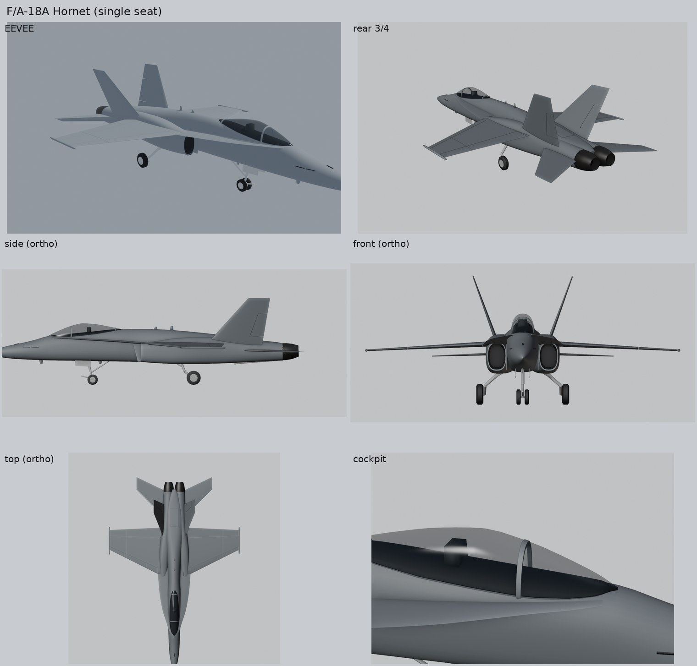
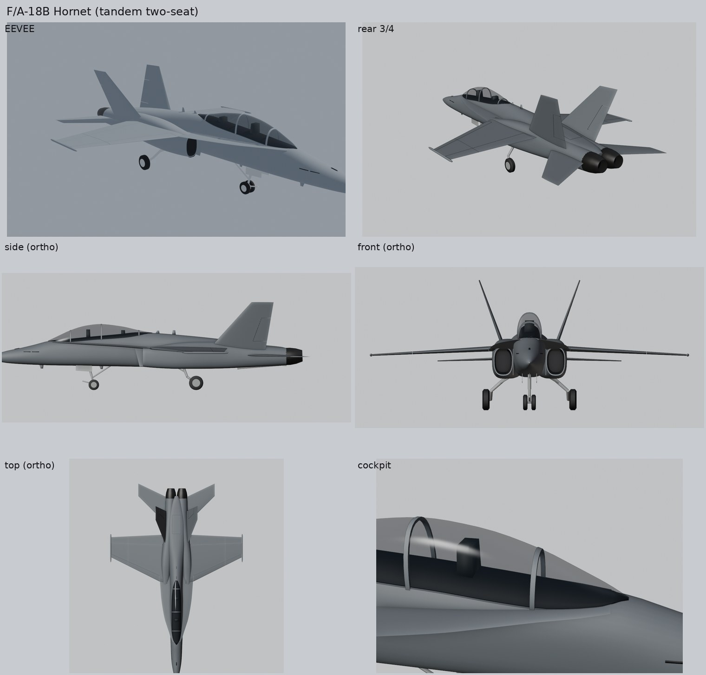

# Legacy Hornet models: F/A-18A and F/A-18B

Two Blender models of the original McDonnell Douglas Hornet, built by one
script from the general-arrangement drawings of the F/A-18A and F/A-18B.
This is the legacy airframe, not the larger F/A-18E/F Super Hornet.

| File | What it is |
| --- | --- |
| `FA-18A_Hornet.blend` | Single-seat F/A-18A |
| `FA-18B_Hornet.blend` | Tandem two-seat F/A-18B |
| `FA-18A_Hornet.glb`, `FA-18B_Hornet.glb` | Same aircraft for game engines: clean airframe, gear down |
| `fa18_hornet.py` | Generator that builds both models. Edit this file, not the meshes. |
| `tools/` | Reference-overlay check, model checks, preview renders |
| `previews/` | Renders of both variants, the stores and the moving parts |




## Variants

The two variants share every part except the cockpit:

- **F/A-18A**: one seat. The canopy runs from 3.22 m to 7.15 m aft of the nose
  tip, with a windscreen bow and a rear canopy frame.
- **F/A-18B**: two seats in tandem. The canopy runs from 3.18 m to 8.70 m aft of
  the nose tip and is taller. It has a windscreen bow, a centre frame between
  the cockpits, and a rear frame. The spine is raised behind it, as drawn on
  the B sheet.

## Regenerating

Tested with Blender 5.3 (the `bpy` module). It uses no 5.x-only API, so it
should also run on 4.2 and newer, but that is untested.

```sh
cd aircraft
blender --background --python fa18_hornet.py -- --variant both --glb
```

`--variant A|B|both`, `--out DIR`, `--glb` (also write .glb files),
`--no-uv` (skip the automatic UV unwrap). You can also open the script in
Blender's Text Editor, set `VARIANT` at the top, and run it. That adds the
aircraft to the open scene.

## Structure and conventions

- Real-world scale in metres. The nose points along −Y, +Z is up, and the port
  wing is on +X.
- One root Empty per aircraft (`FA-18A_Hornet` / `FA-18B_Hornet`), with its
  origin on the centreline at 25 % of the mean aerodynamic chord. It carries
  the custom properties `variant`, `seats`, `length_m`, `span_m` and
  `ground_z` (wheel contact height).
- **Moving parts.** Each moving part is a separate object under a
  `<name>_Hinge` empty that lies on the hinge line. The part rests at zero
  rotation. Rotate it about its local X axis to deflect it. Each part's
  `hinge` custom property records its sign, and it is exported to glTF as
  `extras`:

  | Part | Positive rotation |
  | --- | --- |
  | `Flap_L/R`, `Aileron_L/R`, `Stabilator_L/R` | trailing edge down |
  | `LEFlap_Inner_L/R`, `LEFlap_Outer_L/R` | leading edge down |
  | `Rudder_L/R` | trailing edge to starboard |
  | `Wing_Outer_L/R` | wing folds up (90° = folded) |
  | `SpeedBrake` | opens |
  | `ArrestingHook` | hook down |

  The outer leading-edge flaps and the ailerons ride on the outer wing
  panels, so they fold with them.
- **Collections:**
  - `… Landing Gear`: twin-wheel nose gear with launch bar, and the main gear.
  - `… Optional`: refuelling probe in the extended position, hidden.
  - `… Stores (AIM-9 / AIM-7)`: hidden.
- Materials are flat colours: airframe grey, glass, dark, nozzle, gear,
  tyre and seat. All meshes have Smart-UV-projected UVs, packed into one
  shared space, so they can be textured.

## What was matched to the drawings

All views were registered to the supplied F/A-18A and F/A-18B sheets and
checked by overlaying the model's outline on each drawing
(`tools/overlay_reference.py`).

- **Top view:** nose and forward fuselage, the LEX curve from the windscreen to
  the wing root, wing planform (leading-edge sweep, near-straight trailing
  edge, tip chord), the leading-edge and trailing-edge hinge lines, the
  wing-fold line (model 4.19 m, drawing 4.12 m), stabilator planform, and the
  twin nozzles.
- **Side view:** nose profile, canopy profile for each variant, spine, the
  twin-fin outline and rudder, nozzle end, intake face, the spine and belly
  blade antennae, and the nose- and main-wheel positions.
- **Front view:** canopy height, fin cant and tip positions, fuselage and
  nacelle outline, wing height and anhedral, stabilator line, wheel track,
  and the main-gear legs leaving the nacelle bottom inboard of the AIM-7
  station.
- **Dimensions from the sheet and published specifications:**
  - length 17.07 m, span 11.43 m, height 4.66 m, wing area 37.16 m²
  - 5 % root and 3.5 % tip sections (NACA 65A005 / 65A003.5 mod)
  - tailplane span 6.58 m
  - wheel track 3.11 m, wheelbase 5.42 m
- **Values I supplied and then checked against the drawings:**
  - taper 0.35 with 20° quarter-chord sweep, which gives 26.6° at the leading
    edge against the commonly quoted 26.7°
  - fold line for an 8.38 m folded width
  - 20° fin cant
  - 3° wing anhedral and 2° tailplane anhedral
- **Characteristic details:**
  - wing fold, leading-edge and trailing-edge flaps, ailerons, all-moving
    stabilators, rudders, dorsal speed brake
  - 20 mm cannon port on top of the nose, gun-bay gas vents
  - intake splitter plates
  - arresting hook, nose-gear launch bar
  - refuelling probe on the starboard side, optional
  - wingtip launcher rails
  - two dorsal and two ventral blade antennae
- **Stores** (optional, hidden by default): only the loadout drawn on the
  sheets. An AIM-9 sits on each wingtip launcher, outboard of the rail as in
  the front view, and an AIM-7 sits semi-recessed at each nacelle-corner
  fuselage station. `tools/check_model.py` confirms they clear the gear and
  the control surfaces.

## Limits

- **Drawing accuracy.** The sheets are small, line-art scans, so registration
  is good to about ±0.05–0.1 m. The two sheets also disagree slightly. For
  example, the A sheet's ground line implies a height of about 4.57 m against
  the published 4.66 m. Where they conflicted, published dimensions won.
- **Cross-sections.** The drawings give only silhouettes and no fuselage
  station cuts. Cross-sections are therefore smooth shapes fitted to the top,
  side and front outlines, and the front view is their only check.
- **Wing and LEX height.** The side view puts the LEX edge about 0.1 m higher
  than the front view puts the wing root. The model splits the difference,
  with the wing mid-plane at 0.50 m at the LEX junction.
- **Simplified parts:**
  - The intakes are rounded openings with a short dark duct; there is no
    internal duct to the engine face.
  - The landing gear is simplified to struts, braces and wheels. The
    main-gear bay doors are omitted because the drawings don't show them
    clearly.
  - The AIM-7 sits about 0.2 m aft of the drawn position so its wings clear
    the gear leg.
- **Left out on purpose:**
  - Panel lines and access-panel outlines. They are not modelled as geometry,
    to avoid decorative lines that don't follow the airframe; add them in a
    texture if wanted.
  - LEX fences, which are not on these drawings.
  - Formation lights, pitot tubes, probe-door outlines and markings.
  - Wing pylons and bombs. They appear only in the stores-laden front view,
    and their stations aren't dimensioned there.
- **Flight model.** This repository has no flight model or game code, so no
  flight behaviour was changed and no performance values were added.
